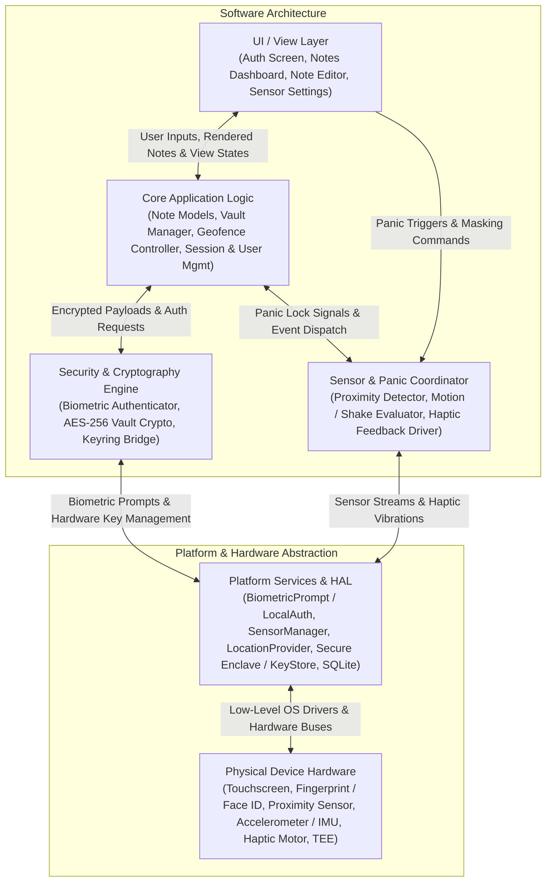
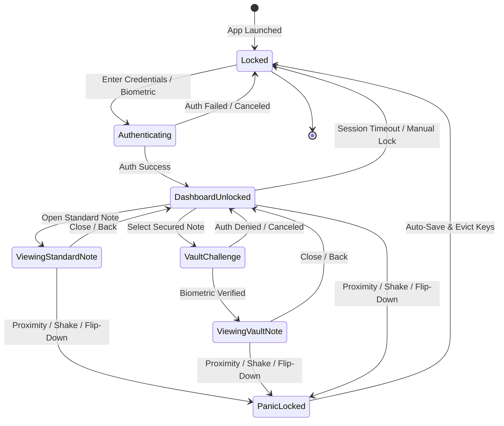
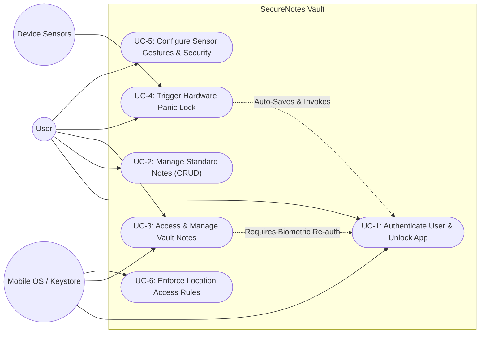

# System Requirements and UML Architecture Diagrams

This document defines the formal software-hardware codesign architecture, system requirements, and UML diagrams for the SecureNotes Vault.

---

## 1. Components View and Component Interactions

The following high-level component diagram illustrates the primary functional blocks of the Mobile Systems and Apps (MSA) architecture and the consolidated relationships between them.

### High-Level Component Interactions
* **UI / View Layer & Core Application**: Handles user navigation, note authoring, category filtering, and real-time masked/unmasked note presentation.
* **UI / View Layer & Sensor & Panic Coordinator**: Routes direct emergency gestures and receives screen masking/window dismissal events.
* **Core Application & Security & Cryptography Engine**: Manages encryption/decryption of vault notes, user session validation, and biometric challenges.
* **Core Application & Sensor & Panic Coordinator**: Dispatches background panic signals, coordinates automatic draft saves, and triggers immediate state lock.
* **Security Engine & Platform HAL**: Delegates biometric validation to native OS prompts (`BiometricPrompt` / `LocalAuthentication`) and derives encryption keys from the secure hardware keystore.
* **Sensor Coordinator & Platform HAL**: Registers listeners with `SensorManager` (proximity, accelerometer) and dispatches haptic pulses via the device vibrator service.
* **Platform HAL & Physical Device Hardware**: Bridges mobile OS subsystem calls to underlying silicon (IMU, biometric reader, TEE, and haptic actuator).

---

## 2. Main State Machine

The state machine defines the high-level operational lifecycle of the SecureNotes Vault application and its transitions across operational and emergency states.

### State Definitions
* **Locked**: Initial and secured state; local decryption keys are evicted from memory, and the login/lock interface is presented.
* **Authenticating**: Primary app entry verification using native biometrics or fallback credentials.
* **DashboardUnlocked**: Main operational hub; standard notes are visible, and vault note contents remain masked.
* **ViewingStandardNote**: Editor/viewer open for an everyday note with active background sensor monitoring.
* **VaultChallenge**: Modal biometric or PIN challenge required prior to decrypting a secured note.
* **ViewingVaultNote**: Decrypted vault note displayed in volatile memory; sensor panic detection is active.
* **PanicLocked**: Immediate emergency state triggered by sensor gestures; persists open changes, purges cached plaintext, and transfers control to `Locked`.

---

## 3. Use-Cases Diagram

The following use-case model illustrates the core functional capabilities of the system and primary interactions with the User, Device Sensors, and the Mobile Platform Security subsystem.

### Use Case Summary

| Use Case ID | Name | Primary Actor | Description |
| :--- | :--- | :--- | :--- |
| **UC-1** | Authenticate User & Unlock App | User / Mobile OS | Authenticates identity via native biometrics (Touch/Face ID) or PIN to unlock the app. |
| **UC-2** | Manage Standard Notes | User | Creates, views, updates, filters, and deletes regular unencrypted daily notes. |
| **UC-3** | Access & Manage Vault Notes | User / Mobile OS | Enforces per-access biometric validation to view, edit, or delete encrypted confidential notes. |
| **UC-4** | Trigger Hardware Panic Lock | Sensors / User | Detects flip-down, proximity covering, or shake gestures, auto-saving data and instantly locking the app. |
| **UC-5** | Configure Sensor Gestures | User | Customizes gesture toggles, shake sensitivity sliders, and authentication preferences. |
| **UC-6** | Enforce Location Access Rules | Mobile OS | Validates device GPS against configured safe zones to restrict or allow access to specific notes. |
